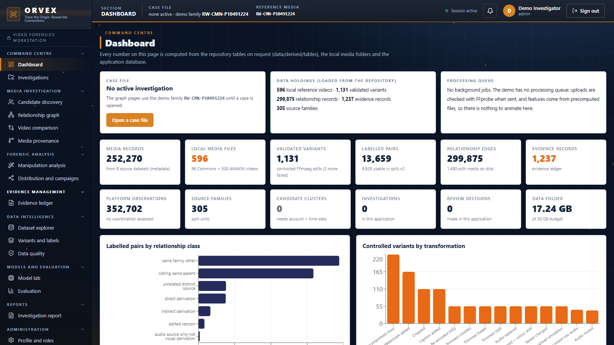
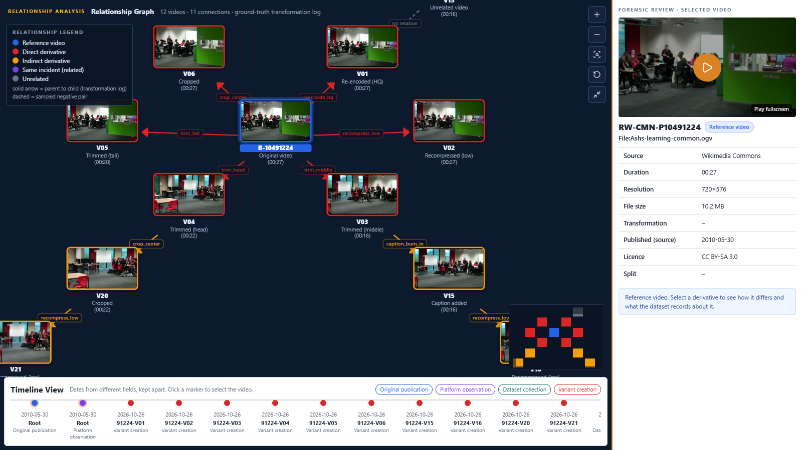
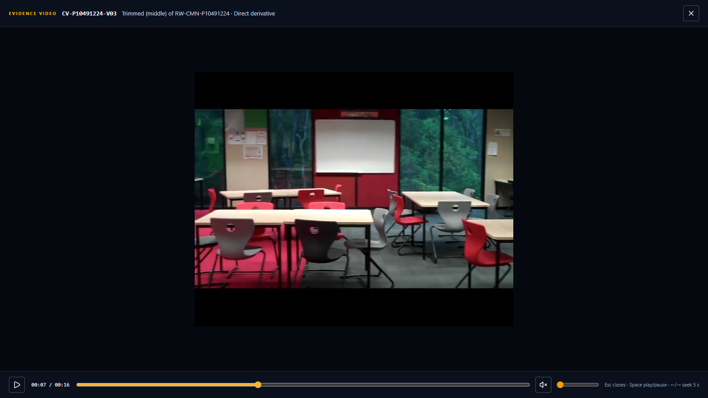
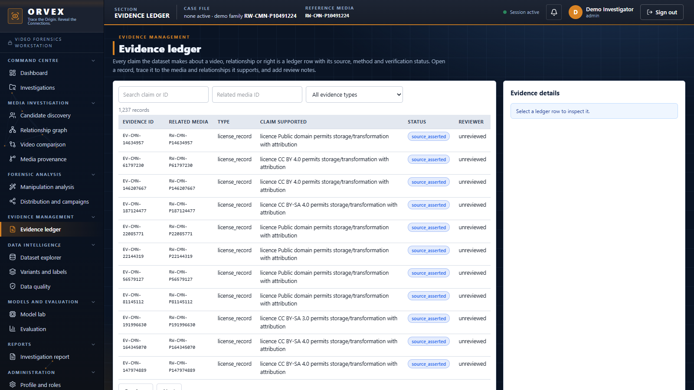
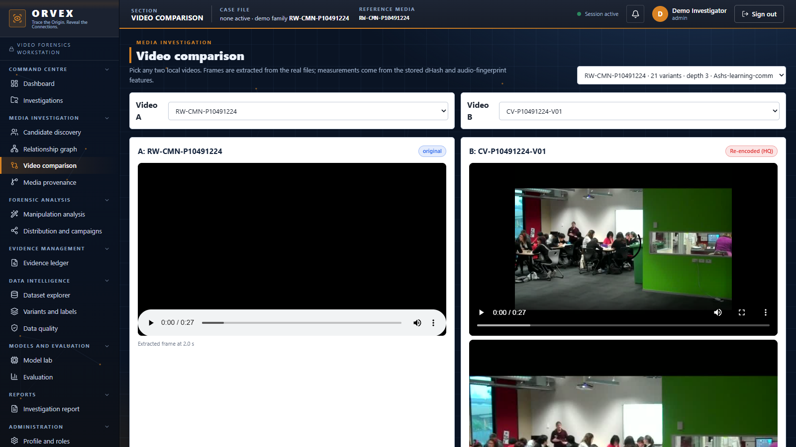

# ORVEX Prototype

**ORVEX - Origin and Relationship Verification Explorer.** *Trace the Origin. Reveal the Connections.*

Hackathon submission for **IDEA//FORGE Online Hackathon** (capstone project PW_27_BS_01, PES University).

| | |
|---|---|
| **Live demo** | {{SPACE_URL}} |
| **GitHub** | {{GITHUB_URL}} |
| **Videos and large tables** | {{DATASET_URL}} (Hugging Face dataset) |
| **Demo sign-in** | `demo.investigator@orvex.local` / `OrvexDemo!2026` (public demo account, no real data) |

> **Honest scope.** The prototype shows relationships taken from a **log of controlled FFmpeg edits** (ground truth) on real public videos, plus simple **non-learned measurements** (perceptual hash and audio fingerprint). It does **not** contain a trained model, and the graph is **not** a model prediction. See [Known limitations](#known-limitations).

## The problem
The same video is trimmed, cropped, captioned, re-compressed and re-shared again and again. Looking at two files, it is hard to say whether they are related, which one came first, and what exactly was changed. Investigators and fact-checkers need the parent-child chain **and** the evidence behind it, with a human making the final call. Similarity alone does not prove derivation, and derivation does not prove coordination.

## What ORVEX is
ORVEX finds and explains how a reference video and other videos are connected: relationship type, parent-child direction, what was changed, and the evidence, kept in a ledger and reviewed by a person. The full system design (not all built) is in `docs/design/` and `docs/datasets/`.

## What the prototype does today
| Area | What you can do |
|---|---|
| Sign-in and dashboard | Sign in; see live counts computed from the dataset tables |
| Investigations | Create a case file with a reference video; add review decisions; download a PDF report |
| Candidate discovery | See every known variant of a reference video with measurements and evidence links |
| **Relationship graph** | Interactive graph with real thumbnails; direct and indirect derivatives; **fullscreen graph workspace**; play any selected video **fullscreen over the expanded graph** and press Esc to return to the same graph |
| Video comparison | Two videos side by side, frame slider, metadata and dHash / audio measurements |
| Media provenance | Lineage tree from the root video through each edit |
| Manipulation analysis | The 14 edit types with examples and how the baseline detects each |
| Distribution and campaigns | Platform observations (coordination is explicitly *not assessed*) |
| Evidence ledger | 1,237 evidence records with claim, source and status |
| Dataset explorer, variants and labels, data quality | Browse the real dataset tables and the checks run on them |
| Model lab and evaluation | The measured dHash baseline and the *specified* (not built) learned model |

Screenshots:







## Architecture
```
Browser -> Hugging Face Space (Docker): React app + FastAPI (+ FFmpeg), SQLite for cases and reviews
                                     -> reads CSV/JSONL tables from the repository
                                     -> streams videos from the Hugging Face dataset (HTTP redirect, seeking works)
```
Details: [`PROTOTYPE_IMPLEMENTATION.md`](PROTOTYPE_IMPLEMENTATION.md).

## Technology stack
React 19 + TypeScript + Vite + Tailwind CSS, React Flow (graph), Recharts; FastAPI + Uvicorn, pandas/NumPy, SQLite, PyJWT, ReportLab/Matplotlib; FFmpeg/FFprobe; OpenCV for the offline feature scripts; Docker; Hugging Face Spaces and Datasets; GitHub.

## Dataset overview
All numbers come from the tables in `data/derived/tables/`.
- 252,270 media records from 8 source datasets (metadata); **596 videos with files**: 96 from Wikimedia Commons and 500 from ANAKIN.
- **1,131 validated controlled variants** made from 55 Commons videos with FFmpeg (14 edit types T01-T14; T11-T14 held out for testing), each with logged parameters and parent. Deepest chains have depth 3.
- 13,659 labelled pairs in 7 relationship classes; 305 source families split train/validation/test by family.
- Stored features: a dHash (24 frames per video) and an audio fingerprint for each of the 1,727 local videos; no embeddings, OCR or speech features.
- Measured baseline (non-learned dHash, threshold 0.45): test ROC-AUC 0.8307; it finds 82.3% of direct derivations but only 3.6% of crops and 14.3% of mirrored copies (mirror rests on 7 pairs).
- The 1,727 videos (16.58 GB) are in the Hugging Face dataset with their original licences recorded in `data/media_manifest.csv`. See [Licences](#licences-and-attribution).

## Run locally
```
pip install -r requirements.txt                 # Python 3.12
cp .env.example .env                            # set ORVEX_MEDIA_BASE to the dataset address (see above); export the variables
python scripts/fetch_data.py                    # 3 large tables (~410 MB). Add --media to download all videos (16.6 GB) for offline use
cd frontend && npm ci && npm run build && cd ..
python -m uvicorn main:app --app-dir src/orvex/api --port 8000      # open http://localhost:8000
```
FFmpeg must be on PATH (or set `ORVEX_FFMPEG`). Development with hot reload: API on 8001 and `cd frontend && npm run dev`.

### Environment variables
| Variable | Meaning |
|---|---|
| `ORVEX_MEDIA_BASE` | Address of the dataset (`.../resolve/main`); videos missing on disk are read from here |
| `ORVEX_SECRET` | Key used to sign login tokens (set it in production; never commit it) |
| `ORVEX_APP_DIR` | Writable folder for the SQLite database, uploads and thumbnails |
| `ORVEX_CORS`, `ORVEX_LOG`, `ORVEX_FFMPEG` | Optional |

## Deployment
Hugging Face Space (SDK: Docker) built from `Dockerfile`; variable `ORVEX_MEDIA_BASE` and secret `ORVEX_SECRET` set in the Space settings. The Space downloads the three large tables when it starts. Cases, reviews and uploads live on temporary disk and reset when the Space restarts.

## Tests
`python -m pytest -q tests/test_dataset_package.py` (34 pass; 4 whole-dataset checks are skipped unless the full local dataset exists) and `tests/browser/ui_workflow_test.py` (58 browser checks).

## Known limitations
- **No trained model.** Edges in the graph are the controlled transformation log; numbers beside them are dHash / audio measurements. The learned model (DINOv2 + similarity head) is designed, not built. No embeddings, OCR or speech features.
- Candidate discovery lists known variants of the chosen reference; searching a large unlabelled collection is not implemented.
- Uploads are only validated with FFprobe and stored.
- "Same incident" relations exist only as metadata (no local video), so purple nodes never appear.
- Many read endpoints do not check the login token in the backend; fine for a public demo of public data, not for real casework.
- Case files and reviews reset when the free Space restarts.
- Tested in Chrome only; phone layouts not tested.

## Licences and attribution
- **Videos.** Originals come from Wikimedia Commons (CC BY, CC BY-SA, CC0 or public domain, recorded per file) and from the ANAKIN dataset (CC BY 4.0 according to its dataset card). Variants are edited copies; variants of CC BY-SA sources stay under CC BY-SA. Authors, titles and licences are in `data/manifests/attribution.csv`, `docs/datasets/ORVEX_ATTRIBUTION.md` and `data/media_manifest.csv`. ANAKIN's videos originate from Vimeo; the CC BY 4.0 licence is taken from the ANAKIN dataset card and was not re-verified for every underlying creator. If you are a rights holder and want a file removed, open an issue.
- **Third-party datasets** (FIVR, VCSL, FVC, COVID misinformation tweets) appear as **metadata only**; no videos from them are redistributed.
- **Code.** Written for this capstone and hackathon. No open-source licence has been chosen yet; the authors will add one.

## Team
Capstone PW_27_BS_01, PES University. Guide: Prof. Bharathi D S. Team: Chiranthan B S Raj, Bhuvan Kumar P, A Raviteja, Darshan G S.
