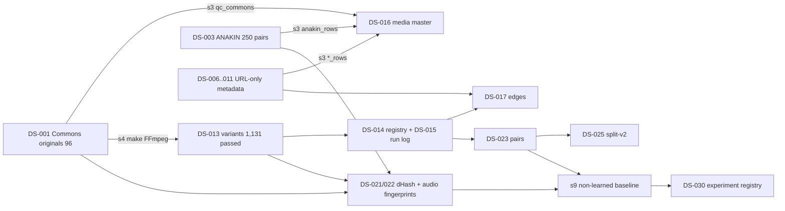

# Dataset Lineage and Relationships

Each node/arrow is a function recorded in `docs/datasets/repository_audit/dataset_lineage.csv` (1,151 rows: dataset-level + one row per variant). Only the controlled-variant chain is record-level; native relations are source-annotated, not recorded transformations.

## Join keys
| key | joins |
|---|---|
| media_id | master <-> edges <-> observations <-> pairs <-> features (`RW-<src>-...` natural, `CV-P<pageid>-Vnn` variants) |
| native_record_id / native_media_id | native files <-> master |
| root_source_media_id | variants -> real source (family id for splits) |
| evidence_id | edges/pairs/master -> evidence ledger |
| relationship_id | pairs -> edges |
| source_family_id | pairs/split manifest |

## Integrity checks (live audit)
| link | dangling rows |
|---|---|
| training_pairs.media_a_id -> master/variants | 0 |
| training_pairs.media_b_id -> master/variants | 0 |
| training_pairs.relationship_id -> edges | 0 |
| training_pairs.evidence_id -> evidence_ledger | 0 |
| edges.media_a_id -> master/variants | 0 |
| edges.media_b_id -> master/variants | 61 |
| edges.evidence_id -> evidence_ledger | 0 |
| observations.media_id -> master | 0 |
| observations.evidence_id -> evidence_ledger | 0 |
| master.evidence_id -> evidence_ledger | 0 |
| duplicate_map ids -> master | 0 |
| feature_manifest.media_id -> master/variants (excl. ALL_LOCAL) | 0 |
| variant.root_source_media_id -> master | 0 |
| variant.direct_parent_media_id -> master/variants | 0 |
| run_log.variant_media_id -> variants | 0 |
| split_manifest.source_family_id -> master/ANAKIN families | 0 |
| group_examples member ids -> master/variants | 0 |

Known relationship defects: 61 FIVR edges with missing endpoints; 3,543 FIVR IS edges unnormalised; variant `CV-P87190658-V10` failed validation yet its file exists. Overlapping collections (shared YouTube ids): RW-03/RW-04=188; RW-03/RW-05=49; RW-03/RW-06=112; RW-04/RW-05=56; RW-04/RW-06=13
Split leakage: cross-split pairs 0; near-duplicate original pairs across splits 9 (review candidates).
Recorded vs inferred: parent-child links exist only for controlled variants and ANAKIN (source-annotated); no model-inferred relationship is stored anywhere.